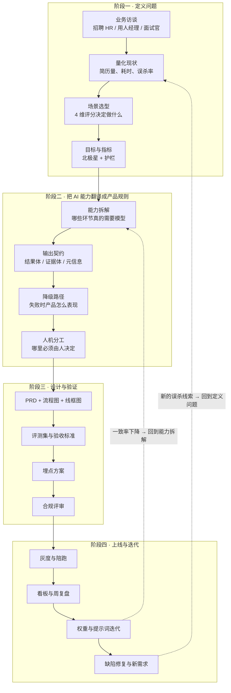

# AI 产品经理工作台 · 总览

> 这份文档回答一个问题：**这个 AI 招聘平台从想法到上线，AI 产品经理具体做了哪些事、产出物长什么样。**
>
> 写作立场：不是「AI 产品经理应该做什么」的方法论清单，而是**这个项目里实际发生了什么** ——
> 包括判断错了要回头改的地方。判断的依据尽量落到可验证的证据上（数据、实验结果、法务意见），
> 而不是「业内通常这么做」。

---

## 0.1 先看这张图：PM 的活是怎么流动的



注意那两条虚线回头路 —— **AI 产品很少是线性的**。这个项目做到一半就回头改过两次：
一次是发现「未体现」和「不符合」被混为一谈，一次是发现面试官指派是静默失效（详见 03）。

---

### 0.1.1 产品由四大模块构成（不要只看到招聘三段）

| 模块 | 覆盖环节 | 需求 | 为什么它不可省 |
| --- | --- | --- | --- |
| M1 岗位能力模型 | 底座 | R-01 ~ R-06 | 三个业务出口共用的标准载体 |
| M2 简历筛选 | 找对人 | R-07 ~ R-14 | 价值最高、容错可控的核心场景 |
| M3 面试助手 | 面准人 | R-09、R-10、R-14、R-25 ~ R-27 | 面试评价数据化的唯一入口 |
| **M4 培训考核** | **培养好人** | R-11、R-15、R-18、R-21 ~ R-24 | **唯一的「结果信号」来源** |

**M4 为什么要单独强调**：招聘的终点不是入职。简历筛选与面试评价都是**过程信号** ——
它们只能说明「AI 的判断像不像 HR」；只有**试用期表现**能回答「当初的判断到底对不对」。
培训考核是产生这个信号的地方，所以它的题库必须锚定岗位能力项
（与筛选、面试共用同一套能力模型），考核成绩才具备预测能力。

没有 M4，整个产品衡量的是一致性而不是准确性 —— 这是它必须进一期的理由。

## 0.2 交付物清单

| 编号 | 文档 | 回答什么问题 |
| --- | --- | --- |
| 01 | [总览（本文）](01-AI产品经理总览.md) | PM 的活怎么流动、交付物之间什么关系 |
| 02 | [需求与场景选型](02-需求定义与场景选型.md) | 做什么、不做什么，依据是什么 |
| 03 | [决策记录 ADR](03-关键决策记录ADR.md) | 为什么这么设计，当时考虑了什么 |
| 04 | [线框图](04-线框图.html) | 20 个页面长什么样 |
| 05 | [页面与交互规格](05-页面与交互规格.md) | 每个页面的字段、状态、异常 |
| 06 | [AI 能力与评测集](06-AI能力与评测集.md) | 怎么证明 AI 是准的 |
| 07 | [埋点与指标体系](07-埋点与指标体系.md) | 上线后靠什么判断好坏 |
| 08 | [上线与运营](08-上线计划与运营.md) | 怎么推、怎么陪跑、怎么迭代 |
| 09 | [风险与合规](09-风险与合规.md) | 哪里会出事，怎么防 |
| 10 | [协作与交付](10-协作与交付.md) | 怎么和研发/设计/测试配合 |

**和已有三份文档的关系**：

```
需求分析文档.md  ── 面向决策层：为什么做这件事
PRD.md          ── 面向研发与测试：做成什么样
流程图.md        ── 面向所有人：怎么流转
产品设计/       ── 面向 PM 自己：我的活是怎么干的
```

前三份是**给别人看的结论**，这一份是**过程与依据**。结论会变，依据要留痕。

---

## 0.3 这个岗位的四条判断准则

写在最前面，因为后面所有取舍都由它们推导。**每条都附了在本项目里的一次真实应用。**

### 准则一：先确认问题是「能力问题」还是「流程问题」

不是所有招聘的低效都该用 AI 解决。如果瓶颈是「HR 要手工填 8 个字段」，
那是流程问题，做个下拉框就够了，上模型反而更慢更贵。

> **本项目的应用**：访谈后发现真正的瓶颈是「简历要逐份读、读了还难以横向比较」，
> 这是**信息处理量**问题，模型擅长。而「面试安排找不到面试官」是纯粹的流程与数据问题，
> 我们没有用 AI 去猜面试官，而是让系统把候选人的业务线、面试官的负载摆出来让人选。

### 准则二：AI 输出必须可溯源，否则无法被信任，也无法被追责

一个「83 分」如果点不开、看不到依据，HR 只有两个选择：全信或全不信。
两者都会让产品失效 —— 全信会把误判放大，全不信则等于没用。

> **本项目的应用**：所有打分类能力强制返回**证据体**（原文片段 + 起止位置），
> 且必须能在原文中定位；定位不到直接判为失败并转人工（见流程图第 3.1 节）。
> 这条约束让「展开锚点」「查看依据 (4)」成为可能 —— 那是信任的入口，不是装饰。

### 准则三：把「AI 说不准」变成产品的一部分，而不是藏起来

模型一定有不确定的地方。把它藏起来，用户会在最需要判断的地方失去支撑；
把它显式化，用户就知道该在哪里多花时间。

> **本项目的应用**：
> - 「未体现」不给分、也**不计入分母** —— 避免因为简历写得简略而被判为能力差；
> - 置信度只用于**分流**，不展示给业务方 —— 防止业务方把 0.62 当成「62 分」；
> - 中档候选人**禁用批量通过** —— 这部分恰是模型最没把握的样本，有意增加操作成本；
> - 降级必须在界面明示 —— 否则用户会把兜底结果当成正常结论采信。

### 准则四：不承担「不可撤回」的动作

平台的输出是**建议**。一旦让系统直接发出拒信，误判就变成了不可撤回的事实。

> **本项目的应用**：系统里根本没有「拒绝」这个动作，只有「待定池 → 归档」，
> 归档不发送任何通知，是否告知由 HR 在 ATS 另行操作。这是法务评审时确定下来的边界，
> 它同时也是一个产品决定：**把不利决定的执行权留在人手里。**

---

## 0.4 一个 AI PM 和一个传统 PM 的差别在哪

不是「会调模型」，而是这三件事：

| | 传统 PM | AI 产品经理 |
| --- | --- | --- |
| 需求描述 | 描述功能与流程 | 还要描述**模型的输入输出契约**与**失败时的表现** |
| 验收标准 | 功能是否按流程走通 | 还要**准确率、覆盖率、一致性**怎么量化 |
| 风险 | 需求变更、延期 | 多了**模型不稳定性、幻觉、偏见、静默降级** |
| 上线 | 发布即完成 | 发布只是开始，**需要持续看一致率与误杀率** |

最容易被忽略的是第二列最后一行。传统产品发布完功能就结束了；
AI 产品的质量是**在真实数据里长出来的** —— 所以第 08 份文档（上线与运营）才是重头。

---

## 0.5 本项目的规模基线

给后面所有文档一个量感参照：

| 维度 | 数值 |
| --- | --- |
| 需求条目 | 27 条（Must 20 / Should 5 / Could 2） |
| 页面 | 20 个（含 1 个免登录候选人页） |
| 角色 | 8 个（含超管） |
| AI 能力 | 11 项，分 5 类模型分层选型 |
| 培训考核 | 7 条需求（R-11、R-15、R-18、R-21 ~ R-24），2 个角色（带教人 / 新人） |
| 培训考核的定位 | **唯一的「结果信号」来源**：试用期表现是验证筛选标准的唯一依据 |
| 流程图 | 22 张 |
| 接口 | 92 个路径 |
| 后端测试 | 4 个套件，含 50 项面试/业务线专项 |
| 评测集 | 80 份标注简历，5 个维度 |

---

## 0.6 怎么读这套文档

- **要快速了解全貌** → 读本文 + [线框图](04-线框图.html)
- **要评审「该不该做」** → 读 [需求与场景选型](02-需求定义与场景选型.md)
- **要评审「为什么这么设计」** → 读 [ADR](03-关键决策记录ADR.md)
- **要接手开发** → 读 [PRD](../PRD.md) + [页面交互规格](05-页面与交互规格.md)
- **要评估 AI 质量** → 读 [AI 能力与评测集](06-AI能力与评测集.md)
- **要接手运营** → 读 [上线与运营](08-上线计划与运营.md)
