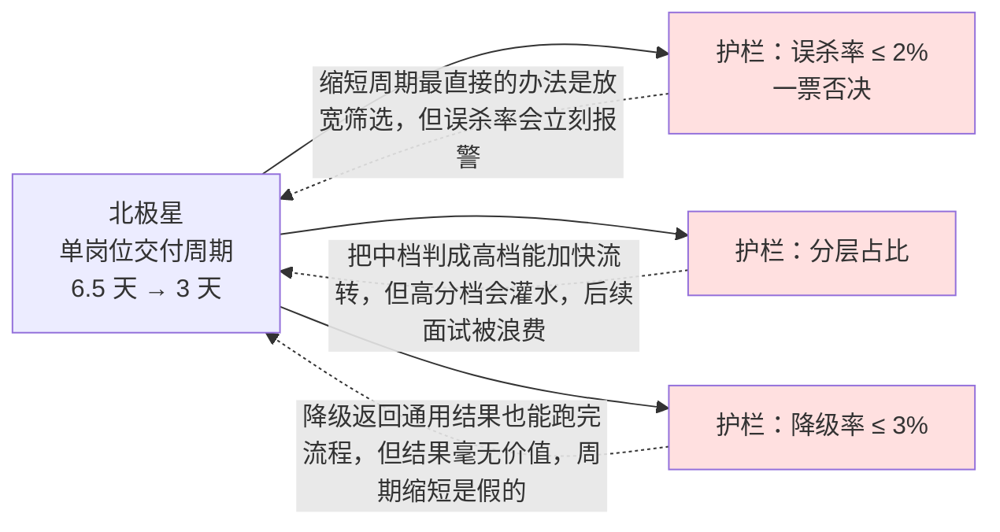

# 需求定义与场景选型

> 这一份回答：**做什么、不做什么，依据是什么。**
>
> 需求文档里最没价值的一句话是「提升招聘效率」。有价值的是：
> 哪一步、从多少到多少、怎么量、什么时候算没做成。

---

## 1 业务访谈：先听，再问，最后才提方案

### 1.1 访谈对象与问题设计

AI 产品最贵的错误是**照着想象中的流程做**。所以第一轮访谈刻意不问「你希望有什么功能」，
只问最近一次实际发生的事 —— 具体到某一份简历、某一场面试。

| 对象 | 人数 | 核心问题 | 想验证的假设 |
| --- | --- | --- | --- |
| 招聘 HR | 5 | 「上周你筛了多少份？哪一份最花时间？为什么？」 | 瓶颈是阅读量还是判断难度 |
| 用人经理 | 4 | 「你退回给 HR 的简历，通常是什么原因？」 | 双方判断标准差在哪里 |
| 业务面试官 | 4 | 「你开场第一个问题怎么定的？」 | 出题是否需要系统支持 |
| HR 负责人 | 2 | 「你怎么判断一个新 HR 筛得准不准？」 | 能否量化、是否有管理抓手 |
| 法务 / 合规 | 1 | 「哪些信息一旦进入决策链路就是风险？」 | 合规红线在哪 |

**为什么这样问**：问「你希望有什么功能」得到的是愿望清单，
问「上次是怎么做的」得到的是真实约束。前者适合做加法，后者适合做减法 ——
而 AI 产品最需要的是减法。

### 1.2 访谈得到的四个事实

| 事实 | 数据 | 对产品的含义 |
| --- | --- | --- |
| 单份简历初筛耗时 4 分钟 | 26 人访谈 + 6 场跟岗观察实测 | 阅读量是真瓶颈，模型有用武之地 |
| 同一份简历不同 HR 评分分歧大 | 通过名单重合度 68%；两人一致率 78% | 需要**统一底座**（能力模型），而不是更强的模型 |
| 面试官开场问题随意 | 4 人中 3 人凭印象提问 | 出题有明确价值，且应与简历差集挂钩 |
| HR 最怕的不是「AI 不准」 | 5 人中 5 人首选「不准还要我背责任」 | **一键采纳 + 留痕**比提升准确率更关键 |

第四条是这次访谈里最有价值的发现，它直接决定了交互设计（见 ADR-003）。

---

## 2 量化现状：把「效率低」翻译成数字

访谈得到的是感受，立项要的是数字。做法是把主链路拆成 5 段，逐段计时。

| 环节 | 现状（人工） | 目标 | 差多少 |
| --- | --- | --- | --- |
| 简历初读与结构化 | 4 分钟/份 | 60 秒以内（含复核；端到端 P95 ≤ 18 秒） | **约 4 倍** |
| 打分与横向比较 | 依赖个人经验，不可复现 | 一致率 ≥ 85% | 从 0 到 1 |
| 面试题准备 | 面试官自备，平均 25 分钟/场 | 系统出题，人工只做筛选与编辑 | 大幅缩短，且题目锚定能力缺口 |
| 面试评价整理 | 会后回忆，常拖到第二天 | 逐字稿自动结构化 | 从 0 到 1 |
| 培训材料准备 | 新岗位从零准备 2–3 周 | 2 天/岗位 | 由能力模型 + SOP 知识库自动生成后人工校订 |

**为什么目标里混着「倍数」和「从 0 到 1」**：后者是**当前根本不存在的能力**，
不是提速。把它们分开列，是为了避免用「效率提升 80 倍」这种话掩盖
「这件事以前没人做、做了对不对还不知道」的事实。

---

## 3 场景选型：四个维度决定做什么

确定了 23 个候选场景，用四个维度打分。**关键不是分数，是权重怎么定的。**

### 3.1 四个维度与权重依据

| 维度 | 权重 | 为什么是这个权重 |
| --- | --- | --- |
| **误判代价** | 35% | 招聘是不可逆决策，误杀的代价远高于漏放（见洞察二） |
| **可验证性** | 30% | 无法验证的 AI 能力不能上线 —— 会被用户当成玄学 |
| **数据可得性** | 20% | 没有训练/评测数据的能力，准确率无从谈起 |
| **实现复杂度** | 15% | 权重最低：能做对但慢一点，好过做快但做错 |

「误判代价」权重最高的直接后果：**排除了所有「自动淘汰候选人」类场景**，
即便它们在效率上的收益最大。

### 3.2 23 个场景的评分结果（节选）

| 场景 | 误判代价 | 可验证性 | 数据可得 | 复杂度 | 加权 | 结论 |
| --- | --- | --- | --- | --- | --- | --- |
| 简历结构化解析 | 高(3) | 高(5) | 高(5) | 中(3) | **4.05** | ✅ 做 |
| 能力项打分与溯源 | 高(3) | 高(5) | 中(3) | 中(3) | **3.65** | ✅ 做 |
| 面试差集出题 | 中(4) | 高(5) | 高(5) | 中(3) | **4.35** | ✅ 做 |
| 逐字稿结构化 | 中(4) | 高(4) | 高(4) | 中(3) | **3.85** | ✅ 做 |
| 培训内容生成 | 中(4) | 中(3) | 高(5) | 中(3) | **3.70** | ✅ 做 |
| 培训题库与自动判卷 | 中(4) | 高(5) | 高(4) | **高(5)** | **4.50** | ✅ 做 |
| 考核反作弊 | 中(4) | 中(3) | 中(3) | 中(3) | **3.30** | ✅ 做（见下） |
| 面试评分建议 | 高(2) | 低(2) | 低(2) | 中(3) | **2.15** | ❌ 不做 |
| 自动拒绝候选人 | 高(1) | 中(3) | 中(3) | 低(5) | **2.35** | ❌ 不做 |
| 薪资谈判建议 | 高(2) | 低(2) | 低(2) | 低(5) | **2.20** | ❌ 不做 |
| 无人化 AI 面试 | 高(2) | 低(2) | 低(2) | 高(1) | **1.80** | ❌ 不做 |

（评分：5 = 最有利，1 = 最不利；误判代价一列 5 = 代价最低）

**培训题库与自动判卷得分 4.50，是全部场景里第二高**，仅次于简历匹配的 4.8。
原因是它的<b>容错空间满分</b> —— 判错了可以人工复核、可以重考、可以作废后返还机会，
结果不影响候选人，最坏情况只是多花带教人的时间。

**但反作弊这一项（3.30）值得单独说明**：它的加权分不高，却必须做。
因为不做反作弊的后果不是「效果差一点」，而是<b>整个考核数据不可信</b> ——
而考核成绩是产品唯一的<b>结果信号</b>（用于验证筛选标准是否准确）。
数据不可信，回流闭环就断了。所以它属于<b>「分数不高但必须做」的依赖项</b>，
判断依据是它对其他模块的支撑作用，而不是它自己的得分。

**「面试评分建议」被排除是本项目最重要的一个「不做」决定。**
它效率收益很大，但违反准则四：AI 给出分数会立刻产生锚定效应，
面试官倾向于微调而非独立判断 —— 表面上更高效，实际上让评价独立性消失。
所以这一条被明确写进 PRD 的验收标准（A3-5：面试官评分区域无任何 AI 预填值）。

### 3.3 被排除的场景，理由要写下来

排除清单必须留档，否则过几个月会有人重新提出来，而没人记得当初为什么不做。

| 不做的事 | 理由 | 什么条件下可以重议 |
| --- | --- | --- |
| 自动拒绝 / 自动淘汰 | 平台不承担不可撤回的不利决定（准则四） | 法务明确认可 + 客户接受人工复核前置 |
| AI 面试评分建议 | 锚定效应损害评价独立性，且无法验证准确性 | 有独立实验证明不产生锚定 |
| 无人化视频面试 | 候选人体验代价高，收益不确定；且自建音视频要解决穿透、弱网、录制存储 | 有客户明确愿意为它付额外成本 |
| 简历自动去重合并 | 数据可得性差（同一人多份简历的判定无标注数据） | 积累到有可靠标注 |
| 薪资建议 | 敏感度高、外部数据依赖强、与岗位能力模型无关 | 不属于本产品范围 |

---

## 4 目标与指标：北极星是一个，护栏是一组

### 4.1 北极星指标

**单岗位有效候选人交付周期** = 从 JD 发布到产出 3 名通过初面候选人所需天数，**6.5 天 → 3 天以内**。

选它的理由：业务方唯一真正关心的是「多久能给我合适的人」，而不是任何单点效率指标。
它同时反映筛选质量与流程效率 —— 判得不准会让候选人反复退回重排，周期自然拉长。

**为什么不选其他候选指标**：

| 候选指标 | 不选的原因 |
| --- | --- |
| 单份简历处理耗时 | HR 可以靠「多否决」把耗时压下来，反而伤害质量 |
| AI 采纳率 | 可以被刷：放宽阈值、推更多人就能提高 |
| 处理简历数量 | 虚荣指标，量大不等于招到人 |

但**北极星不能单独用**，因为它也可以被刷：把阈值放宽、让更多人进面，周期是短了，
但招进来的人不合格。所以必须配护栏指标。

### 4.2 护栏指标

| 指标 | 定义 | 红线 | 为什么设它 |
| --- | --- | --- | --- |
| **误杀率** | 待定池捞出后通过面试 / 全部捞回 | **≤ 2%** | **一票否决指标**，防止为了缩短周期牺牲召回 |
| **分层占比** | 高/中/低档比例 | 高分档 ≤ 40% | 防止阈值过松导致高分档灌水 |
| **一致率** | AI 档位与 HR 档位一致 / 复核样本 | ≥ 85% | 核心质量指标（人类两两一致率 78%，此为参照上限） |
| **处理耗时 P95** | 单份简历端到端 | ≤ 30s | 防止为了准确率无限加模型 |
| **降级率** | 走降级路径的请求占比 | ≤ 3% | 降级结果观感上与正常结果无差别，最危险 |
| **面试题采纳率** | 采纳题数 / 生成题数 | ≥ 70% | 检验出题是否切中缺口 |
| **引用准确率** | 证据能真实指向原文 / 抽检样本 | ≥ 92% | 证据指向错误会直接摧毁用户信任 |
| **试用期通过率** | 试用期通过人数 / 入职人数 | ≥ 90% | 验证筛选标准与真实绩效的相关性 |

### 4.3 指标之间的关系

**这张图要传达的一件事**：AI 产品的指标必须成对出现。
只有北极星没有护栏，团队会系统性地往错的方向优化。

---

## 5 需求的优先级依据

| 优先级 | 判断标准 | 本项目条目 |
| --- | --- | --- |
| Must | 不做则主链路断，或触碰合规红线 | 20 条 |
| Should | 影响体验与效率，但有替代路径 | 5 条 |
| Could | 锦上添花，资源紧张时可砍 | 2 条（未实现） |

一条需求进 Must 的充分必要条件：**主链路断** 或 **合规红线**。
「客户很想要」「竞品有」都不是理由。

> 例：候选人邀请页进 Must，是因为没有它候选人不知道从哪进视频面试 —— 主链路断。
> 而「面试日程导出日历」只是 Should，因为可以手动复制时间。

---

## 6 这一阶段最容易犯的三个错

| 错误 | 表现 | 怎么避免 |
| --- | --- | --- |
| 把愿望清单当需求 | 「希望 AI 能帮我判断候选人合不合适」 | 只记录**最近一次实际发生的事**，不接受概括性描述 |
| 用准确率当唯一目标 | 追求 95% 准确率，忽略误杀代价 | 强制配上护栏指标，并明确误判代价的方向（宁漏勿杀） |
| 排除的场景不留档 | 三个月后重新讨论，重复踩坑 | 排除清单必须写理由 + 重议条件 |
