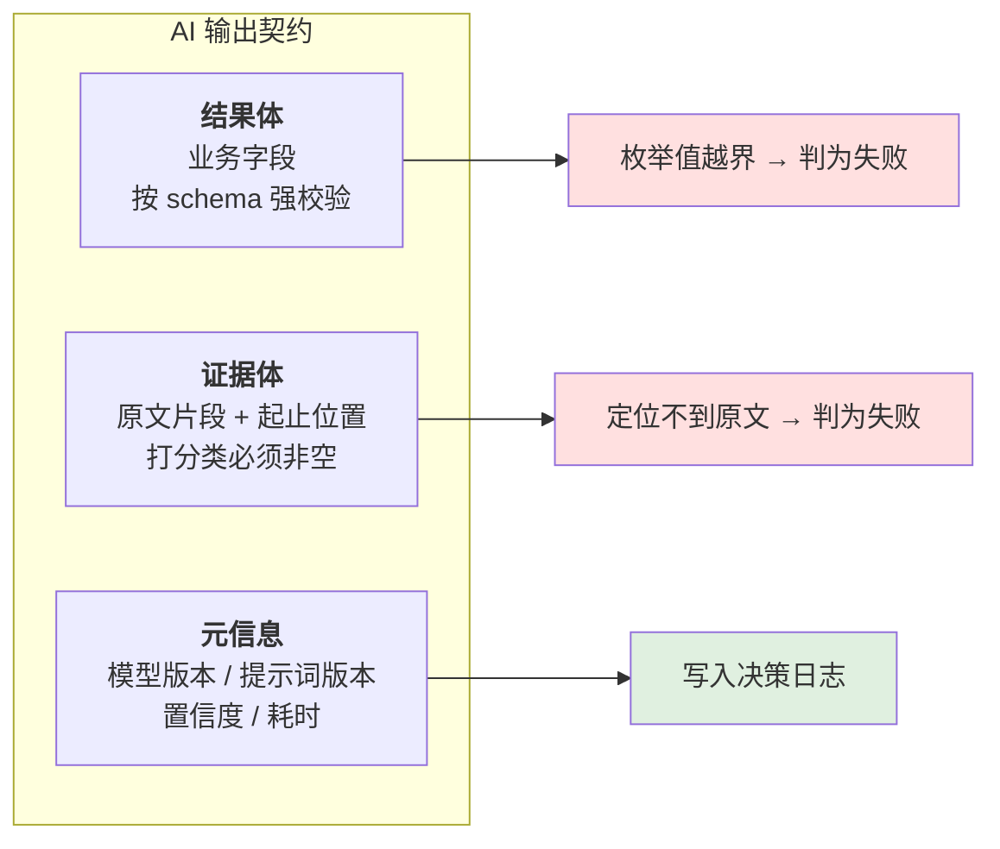
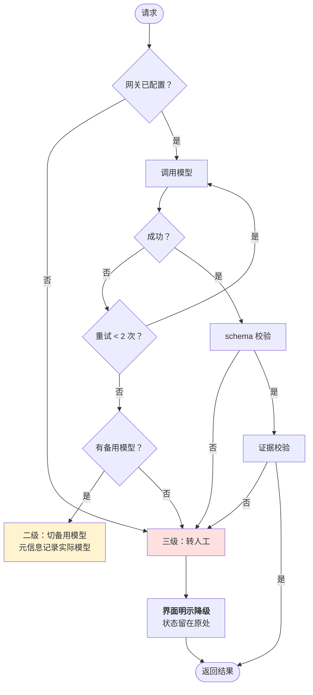
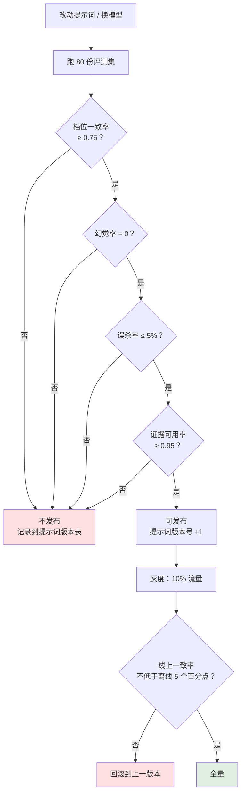
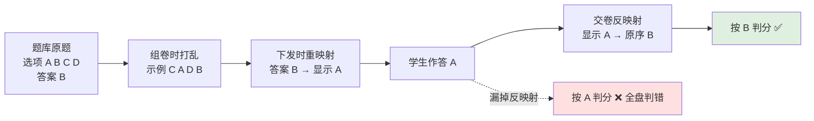

# AI 能力与评测集

> 这份回答一个问题：**怎么证明 AI 是准的。**
>
> 「准」在 AI 产品里不是形容词，是一组要先定好的数字。定不下来的能力不能上线 ——
> 因为上线后没人知道该不该信它。

---

## 1 能力清单：11 项，分 5 类机型

不是每件事都需要最强的模型。按「错了有多贵」和「有多难」分两层选择。

| 技能 | 中文 | 分层 | 为什么是这一层 |
| --- | --- | --- | --- |
| `screen_resume` | 简历解析与打分 | 大 + 视觉 | 错了最贵（影响后续全部判断） |
| `generate_questions` | 面试出题 | 大 | 需要理解差集与岗位语境 |
| `build_interview_report` | 面试报告生成 | 大 | 需要把散乱逐字稿归到能力项 |
| `generate_training` | 培训方案生成 | 大 | 长文生成，结构复杂 |
| `judge_exam` | 判卷（主观题） | 中 | 有明确要点，不需要最强模型 |
| `analyze_jd` | JD 分析 | 中 | — |
| `build_ability_model` | 能力模型建议 | 大 | 影响底座，需谨慎 |
| `query_recruit_data` | 招聘数据查询 | 小 | 结构化取数 |
| `explain_decision` | 决策解释 | 中 | — |
| `search_knowledge` | 知识库检索 | 嵌入 | 向量检索 |
| `pool_rescue` | 待定池捞回建议 | 中 | 需人工确认，错了代价可控 |

**分层依据是两条**：判错代价（影响下游越广，层级越高）与任务难度（开放式生成 > 有约束抽取）。
按模型名硬编码是错的 —— 所以路由用**能力亲和度表**，模型换版本时不用改产品逻辑：

| 模型族 | large | medium | small |
| --- | --- | --- | --- |
| 旗舰（如 opus 系列） | 1.0 | 0.75 | 0.25 |
| 均衡（如 sonnet 系列） | 0.85 | 1.0 | 0.3 |
| 轻量（如 haiku 系列） | 0.1 | 0.6 | 1.0 |

选型时在「能力分层 × 亲和度」里取最高分，并遵守**稳定优先**：
同一批次任务尽量用同一个模型，避免同一批简历里出现两种判断风格。

---

## 2 输出契约：三段结构

所有 AI 产出统一为三段。**这不是技术细节，是产品要求** ——
它决定了界面上能不能做出「查看依据」。

| 校验项 | 规则 | 失败后果 |
| --- | --- | --- |
| 结果体 | 字段齐全 + 枚举值在约定集合内 | 判为失败，转人工 |
| 证据体 | 打分类能力**必须非空**，且能在原文定位 | 判为失败，转人工 |
| 元信息 | **以代码侧为准**，丢弃模型自报版本 | —— |

**为什么要强校验，而不是「大致对就行」**：
一个找不到依据的分数，在界面上点不开，用户就只能全信或全不信。
强校验的作用是把「不可信的输出」挡在界面之外，而不是让它显示出来再让人怀疑。

---

## 3 三级降级：禁止静默降级

### 3.1 为什么降级必须显式

**降级结果与正常结果在观感上没有差别** —— 这是它最危险的地方。
拿到一套通用模板题的面试官，会以为它是针对这位候选人生成的。

所以产品上做了三件事：

1. 降级状态**常驻页面**，不是 5 秒就消失的 toast；
2. 文案明确写「本次题目是降级结果，不是针对该候选人生成的」；
3. 提示「下面是按能力项套用的通用题模板，不能直接用于面试」。

### 3.2 三条降级路径的产品表现

| 级别 | 触发 | 界面表现 |
| --- | --- | --- |
| 一级：重试成功 | 网络抖动 | 用户无感知，元信息记录重试次数 |
| 二级：切备用模型 | 主模型不可用 | 元信息记录实际使用的模型，指标里可见 |
| 三级：转人工 | 校验失败 / 无备用 | **界面常驻提示**，状态留在原处，不产出结果 |

---

## 4 评测集：怎么建、多大、谁来标

### 4.1 构成

| 维度 | 内容 | 数量 |
| --- | --- | --- |
| 正样本 | 已入职且试用期通过 | 30 份 |
| 负样本 | 面试后明确否决 | 30 份 |
| 边界样本 | HR 之间判断不一致的 | 20 份 |
| **合计** | | **80 份** |

**边界样本必须占 25%**。只用正负样本会高估模型 ——
真实场景里最难的是「差不多」的那些人，而不是明显行或明显不行的人。

### 4.2 标注方式

| 项 | 做法 |
| --- | --- |
| 标注人 | 2 名 HR 独立标注 + 1 名 HR 负责人仲裁 |
| 标注内容 | 能力项逐项判定（命中/部分/未体现/不符合）+ 档位 |
| 一致性 | 双标不一致的样本单独成组，**用于校准而不是训练** |
| 版本 | 标注与提示词版本绑定，改提示词必须重跑 |

### 4.3 双人标注的分歧率是重要产出

本项目实测：**40 份双标，档位不一致 11 份（27.5%）。**

这个数字本身比任何模型指标都重要 —— 它说明**人的判断本身就不一致**。
在这个基础上谈「模型准确率 90%」是没有意义的。所以第一个动作不是调模型，
而是统一底座（见 ADR-001）。

---

## 5 评测维度与通过标准

| 维度 | 定义 | 标准 | 当前 |
| --- | --- | --- | --- |
| **档位一致率** | AI 档位 = HR 仲裁档位 | ≥ 0.75 | 0.81 |
| **证据可用率** | 证据能在原文定位 | ≥ 0.95 | 0.97 |
| **能力项召回** | 该发现的问题被发现 | ≥ 0.80 | 0.84 |
| **误杀率** | 低档中实际合格的比例 | ≤ 5% | 3.2% |
| **幻觉率** | 编造简历中不存在的内容 | = 0 | 0 |
| **格式合规** | 三段结构完整且通过校验 | ≥ 0.98 | 0.99 |

### 5.1 幻觉率必须是 0

其他指标都可以有阈值，幻觉率不行。编造一段候选人没写过的经历，
不只是这一个分数错了 —— 整个系统的可信度都没了。

**做法**：证据体强制非空 + 必须在原文定位。模型编造的内容定位不到，直接判失败。

### 5.2 能力项召回为什么比精确率重要

漏掉一个该发现的问题（漏放）的代价，低于把一个好候选人判成不合格（误杀）。
这是需求分析里「误杀的代价远高于漏放」的直接落地。

---

## 6 上线前的评测流程

**每一步都是硬门槛，不设「再加把劲就能过」。**
自动放行的后果是：一次小改动让一致率从 0.81 掉到 0.62，而没人知道。

---

## 7 提示词版本管理

| 项 | 做法 |
| --- | --- |
| 存储 | 集中管理，不在代码里散落字符串 |
| 版本号 | 每次改动递增，与评测结果绑定 |
| 回溯 | 决策日志记录当时使用的版本 |
| 回滚 | 保留历史版本，可一键切回 |
| 约束 | **改动必须重跑评测集**，不能凭感觉发布 |

**为什么必须做成基础设施而不是纪律**：
提示词改动是最容易被当成「改个文案」的操作，而它实际会改变所有下游判断。
把它纳入版本管理，是让这件危险的事变得可追溯。

---

## 8 一处工程陷阱：选项乱序必须反映射

不属于 AI 能力，但属于「AI 出题」的下游，错了会全盘皆错。

**为什么单列出来**：这个错误的结果是「全错」而不是「报错」，
很容易被误认为「这次题目太难」。所以它必须进测试用例，不能只靠 code review。
