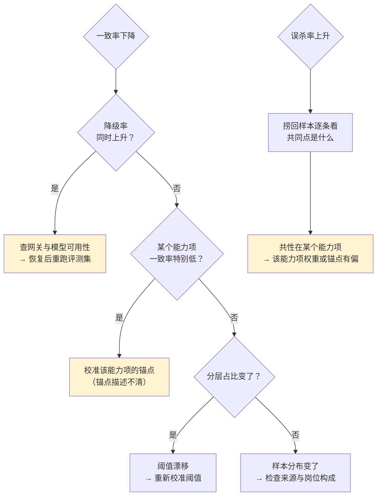
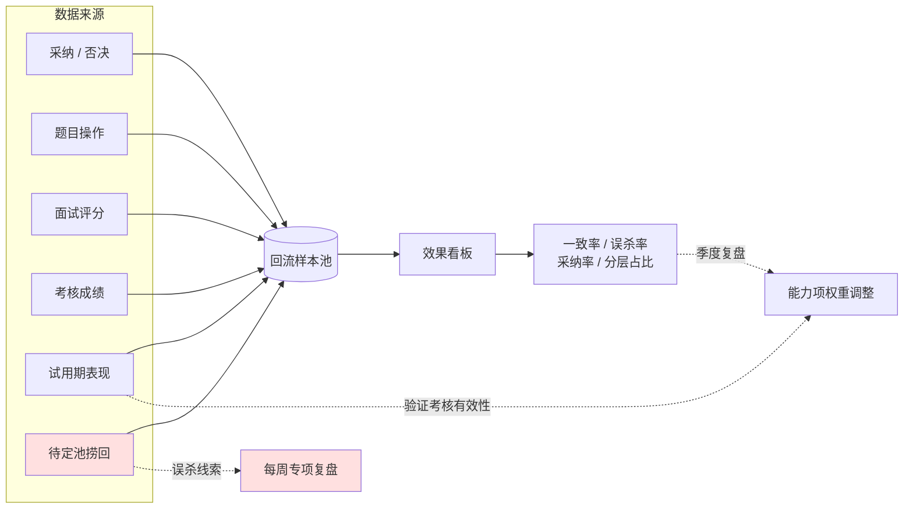

# 埋点与指标体系

> 这份回答：**上线后靠什么判断做得好不好，以及指标坏了该改什么。**
>
> 埋点最容易犯的错是「能埋的都埋上」。结果是看板上有 60 个数字，
> 没人知道哪个该动、动了会怎样。**能对应动作的指标才放上去。**

---

## 1 埋点原则

| 原则 | 说明 | 反例 |
| --- | --- | --- |
| 只埋能驱动决策的事件 | 每个事件都要能回答「所以我该做什么」 | 埋「用户滚动到第几屏」 |
| 埋点带上下文 | 至少含角色、业务线、模型版本 | 只埋「点击了采纳」 |
| 关键动作必埋 | 影响候选人结果的每一步 | 漏埋「标记疑问」（它是误杀线索来源） |
| 不上报个人信息 | 埋点里不放姓名、手机、简历内容 | 埋 `candidate_name` |
| 与服务端动作对齐 | 埋点不能替代服务端日志 | 只靠前端埋点统计采纳率 |

**最后一条尤其重要**：前端埋点会丢（用户关页面、网络失败）。
**影响候选人结果的统计必须来自服务端决策日志**，埋点只用于分析体验。

---

## 2 事件清单

| 事件 | 触发时机 | 关键字段 | 用来回答 |
| --- | --- | --- | --- |
| `resume_imported` | 简历导入完成 | 来源、文件类型、页数 | 数据来源分布 |
| `resume_parsed` | 解析完成 | 耗时、是否需人工补录、缺失字段 | 解析质量 |
| `resume_scored` | 打分完成 | 总分、置信度、档位、模型版本 | 分层是否合理 |
| `evidence_viewed` | 点击能力项看依据 | 能力项、依据数 | **信任度：用户是否愿意看依据** |
| `candidate_adopted` | 采纳 | 档位、操作人角色 | 北极星分子 |
| `candidate_rejected` | 否决 | 否决原因、档位 | 分歧分析 |
| `candidate_doubted` | 标记疑问 | 能力项 | 模型没把握的地方 |
| `pool_rescued` | 捞回 | 进池时长、捞回原因 | **误杀线索** |
| `schedule_created` | 安排面试 | 轮次、方式、面试官、时长 | 排期效率 |
| `interview_consent` | 候选人表态录音 | 场次、是否同意 | 录音路径可行性 |
| `questions_generated` | 出题完成 | 题数、耗时、是否降级 | 出题质量 |
| `question_action` | 采纳/编辑/删除 | 动作、能力项 | 题目采纳率 |
| `report_built` | 报告生成 | 是否降级、耗时 | 报告可用性 |
| `ai_degrade` | 发生降级 | 级别、原因、能力名 | 稳定性 |
| `exam_started` | 开考 | 方案、题数 | — |
| `exam_signal` | 上报信号 | 信号类型、次数 | 反作弊分析 |
| `exam_submitted` | 交卷 | 耗时、客观题得分 | — |
| `exam_graded` | 终评完成 | 终评分、是否作废 | 考核有效性 |

**没有埋的两个**：候选人姓名、简历文本内容。埋点表里不出现个人信息。

---

## 3 指标分层

指标分三层，看的时间粒度不同。

### 3.1 北极星（看每周）

| 指标 | 公式 | 目标 |
| --- | --- | --- |
| **HR 采纳率** | 采纳数 / 复核数 | 逐季提升 |

选它的理由：同时反映「AI 判得准」与「HR 愿意用」。
但**它可被刷** —— 调低阈值就能提高，所以必须配护栏。

### 3.2 护栏（看每周，任一触线即叫停）

| 指标 | 公式 | 红线 | 触线后改什么 |
| --- | --- | --- | --- |
| 误杀率 | 捞回后通过面试 / 捞回总数 | ≤ 5% | 放宽低档阈值 |
| 分层占比 | 高分档占比 | ≤ 40% | 收紧高分档条件 |
| 降级率 | 降级请求 / 总请求 | ≤ 3% | 查网关稳定性与模型可用性 |
| 幻觉率 | 证据定位失败 / 总数 | = 0 | 立即停止发布，回滚提示词 |

### 3.3 质量（看每版本）

| 指标 | 公式 | 目标 |
| --- | --- | --- |
| 档位一致率 | AI 档位 = HR 档位 / 复核样本 | ≥ 0.75 |
| 题目采纳率 | 采纳题数 / 生成题数 | ≥ 60% |
| 证据查看率 | 看过依据的复核 / 总复核 | ≥ 40% |
| 处理耗时 P95 | 单份简历端到端 | ≤ 30s |

**「证据查看率」是这份清单里最特别的一个。** 它不衡量 AI 准不准，
而衡量**用户是否在用它做判断**。如果这个值很低，说明用户只是扫一眼总分就决定 ——
那界面做得再好也没有意义。

---

## 4 指标坏了怎么定位

指标本身不告诉你原因，所以每个指标都要配一条排查路径。

### 4.1 一致率下降的四种原因

| 原因 | 特征 | 动作 |
| --- | --- | --- |
| 降级变多 | 降级率同步上升 | 查模型可用性 |
| 某能力项锚点不清 | 单个能力项一致率显著低 | 改锚点描述 |
| 阈值漂移 | 分层占比变化 | 重新校准阈值 |
| 样本分布变化 | 新来源、新岗位 | 拆开看，别整体调 |

**关键**：不要一看到一致率下降就调提示词。要先分清是**模型变差了**还是**样本变了**——
后者调提示词是白费力气。

---

## 5 一个指标对应一个动作

看板的每条都要能回答「所以呢」。

| 指标 | 不达标时做什么 | 谁做 |
| --- | --- | --- |
| 一致率 < 0.75 | 校准锚点，重跑评测集 | PM + 算法 |
| 误杀率 > 5% | 放宽低档阈值 | PM |
| 题目采纳率 < 60% | 改出题策略（差集权重、题量） | PM + 算法 |
| 证据查看率 < 40% | 界面问题：依据入口不够显眼 | 设计 |
| 耗时 P95 > 30s | 检查模型路由与并发 | 研发 |
| 降级率 > 3% | 查网关稳定性 | 研发 + 运维 |
| 录音同意率低 | 文案问题或不该做这条路 | PM |

**如果一个指标没有对应动作，就不要放进看板** —— 它会变成装饰，
而装饰会稀释真正重要指标的存在感。

---

## 6 每周复盘固定看三件事

不按指标顺序看，按**问题**看。

### 6.1 捞回记录（最重要）

捞回后通过面试的案例 = **一次差点被误杀的实证**。
这是发现误杀模式最直接的入口，所以单独列表、每周由 HR 负责人复盘，
而不是混在总体指标里被平均掉。

要看的是：这些人的共同点是什么？是某个能力项被系统性低估，还是某种简历风格吃亏？

### 6.2 被标记疑问的样本

「标记疑问」是模型没把握、HR 也没把握的地方。这些样本比错误样本更有价值 ——
错误样本告诉你哪里错了，疑问样本告诉你**哪里的标准本身还没定清楚**。

### 6.3 降级明细

降级结果观感上与正常结果没有差别，最容易被漏掉。
每周确认：降级发生在哪些能力上、是否集中在某个模型或时段。

---

## 7 数据回流闭环

**闭环里最短的路径最有价值**：捞回记录 → 每周复盘。
它不需要等到季度，一周就能产生一次权重调整的输入。

### 7.1 试用期表现为什么必须回流

前面所有信号都是**过程信号**（HR 采纳了、面试通过了），
只有试用期表现是**结果信号** —— 它验证的是「当初的判断对不对」。

没有这一路回流，整个体系衡量的是「AI 像不像 HR」，而不是「AI 准不准」。
