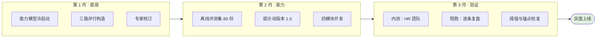
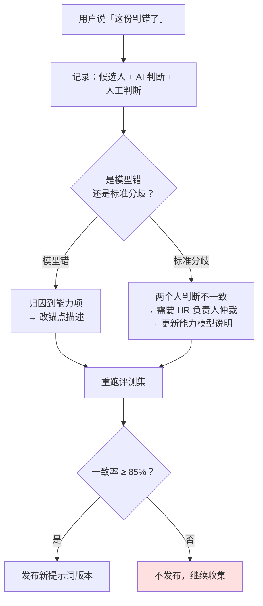
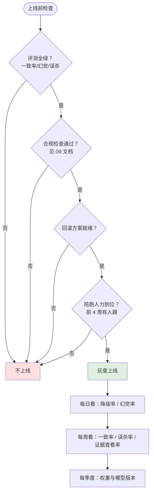

# 上线计划与运营

> 这份回答：**怎么推、怎么陪跑、怎么迭代。**
>
> 传统产品发布即完成，AI 产品发布才是开始 —— 因为质量是在真实数据里长出来的，
> 而离线评测集永远覆盖不了真实样本的分布。

---

## 1 上线前：三个月，三个阶段

### 1.1 能力模型冷启动（第 1 月）

按三路并行构造，**不是拍脑袋定权重**：

| 路径 | 方法 | 产出 |
| --- | --- | --- |
| 正向拆解 | 从岗位 JD 与高绩效员工访谈拆能力项 | 候选能力项清单 |
| 反向挖掘 | 从历史通过/否决样本里找 HR 实际在意的维度 | 权重初值 |
| 专家校订 | 合并去重、确认权重区间、定否决项（≤3） | 定稿模型 |

**为什么三路都要**：单靠 JD 会得到「责任心强」这类无法验证的词；
单靠历史样本会继承历史上的偏见。两路交叉再人工校订，才既有依据又不固化偏见。

### 1.2 内测阶段的三个动作

| 动作 | 做法 | 目的 |
| --- | --- | --- |
| 影子模式 | AI 打分但不展示给 HR，先记录 HR 的判断 | 拿到干净的一致率基线 |
| 逐条复盘 | 每天抽 10 份，AI 判断与 HR 判断并排看 | 找出系统性偏差 |
| 锚点校准 | 对一致率低的能力项，改锚点描述而不是改权重 | 先修描述，再调数值 |

**影子模式是关键**：如果一开始就展示 AI 分数，测出来的「一致率」
其实包含了锚定效应 —— 用户被 AI 影响了，然后你测出他们一致。
这样得到的数字没有意义。

---

## 2 灰度：按业务线，不按用户比例

| 阶段 | 范围 | 时长 | 观察 |
| --- | --- | --- | --- |
| A | 高招聘量部门约 18% 流量 | 2 周 | 一致率、误杀率、证据查看率 |
| B | 2 条业务线、5 名 HR | 2 周 | 跨业务线稳定性、模型成本 |
| C | 全线 | — | 持续监控 |

**为什么不按用户比例灰度**：AI 产品的效果与**业务线数据分布**强相关。
同一业务线内 10% 的用户和 100% 的用户，看到的是同一类简历；
而不同业务线的简历差异极大。按业务线灰度才能真正测到泛化能力。

### 2.1 每个阶段的通过条件

| 阶段 | 通过条件 | 不通过则 |
| --- | --- | --- |
| A → B | 一致率 ≥ 85%、误杀率 ≤ 2%、证据查看率 ≥ 40%、零幻觉 | 留在 A，校准锚点 |
| B → C | 跨业务线一致率差异 < 0.10 | 拆开分别校准，不强行推全量 |

**「跨业务线差异 < 0.10」这条容易被忽略**：整体一致率 0.80 看起来不错，
但如果电商线 0.88、供应链线 0.62，那整体数字是被拉高的，
供应链的用户体验其实很差。

---

## 3 陪跑：上线后前四周

AI 产品的口碑在前四周就定了。这段时间的核心任务不是收集反馈，是**建立信任**。

| 周 | 重点 | 具体动作 |
| --- | --- | --- |
| 第 1 周 | 让用户敢用 | 每天跟 1 名 HR 一起看 10 份，现场解答「为什么这么判」 |
| 第 2 周 | 建立依据习惯 | 引导点击「查看依据」，讲解证据如何定位 |
| 第 3 周 | 收集误判 | 逐条记录用户说「这个判错了」的样本 |
| 第 3–4 周 | **培训考核模块陪跑** | 与带教人一起看前两场考核的信号明细与终评，确认反作弊判据是否被接受 |
| 第 4 周 | 校准与固化 | 用三周的误判样本校准锚点与阈值，固化操作规范 |

### 3.1 陪跑时最该问的一句话

不是「你觉得准不准」，而是：

> **「这一份，如果是你一个人看，你会怎么判？哪里和它不一样？」**

前者得到的是评价，后者得到的**可复用的偏差样本**。
「准不准」只能告诉你满意或不满意；具体到某一份的差异点，才能变成锚点或权重的修改依据。

### 3.2 误判样本的处理流程

**「标准分歧」这一类常被忽略**。用户说「判错了」时，有相当一部分实际是
**HR 之间标准不一致**，而不是模型错。这类要回到能力模型去澄清标准，
调模型是治不好的。

---

## 4 迭代节奏

| 周期 | 做什么 | 输入 |
| --- | --- | --- |
| 每周 | 捞回记录专项复盘 | 待定池捞回样本 |
| 每两周 | 提示词 / 锚点微调 | 陪跑误判样本 |
| 每月 | 阈值校准 + 效果月报 | 看板指标 |
| 每季度 | 能力项权重调整 + 模型版本升级 | 一致率 / 误杀率 / 试用期表现 |

**最小改动原则**：一次只改一个变量（锚点 / 阈值 / 提示词 / 权重），
否则一致率变化了也不知道是哪个造成的。

---

## 5 什么时候该停下来重做

AI 产品要有明确的「止损线」，否则会一直调下去。

| 信号 | 含义 | 动作 |
| --- | --- | --- |
| 连续 2 个季度一致率 < 70% | 能力模型或任务定义有问题 | 回到 ADR-001 重新审视底座 |
| 证据查看率长期 < 20% | 用户根本不看依据 | 重新想价值主张，不是改界面 |
| 误杀率压不到 2% 以内 | 阈值与业务容忍度冲突 | 与业务重新谈误杀代价 |
| 用户绕过产品用回老方法 | 产品没有解决真问题 | 停下，重做访谈 |

**最后一条最重要**。用户绕过系统（比如在别处记笔记、私下用微信群排面试）
是最真实的负反馈 —— 比任何问卷都准。

---

## 6 培训与变更管理

工具改变流程，流程改变习惯。上线培训不能只讲功能。

| 对象 | 培训重点 | 时长 |
| --- | --- | --- |
| 招聘 HR | 怎么看依据、怎么判「未体现」、否决原因怎么写 | 2 小时 |
| 用人经理 | 数据范围、怎么看复核结果 | 1 小时 |
| 业务面试官 | 用什么账号进入会议、怎么看录音意愿、评分怎么填 | 1 小时 |
| 带教人 | 风险分怎么读、什么时候作废 | 1 小时 |
| 系统管理员 | 网关配置、阈值含义 | 1 小时 |

### 6.1 必须讲清楚的三件事

1. **AI 是建议不是决定** —— 采纳与否决由人做，日志记录双方
2. **「未体现」不等于「不会」** —— 这是最容易被误读的一处
3. **看见降级提示要停下来** —— 降级结果不能直接用于面试

### 6.2 变更沟通

| 变更类型 | 提前多久告知 | 说明什么 |
| --- | --- | --- |
| 阈值调整 | 上线前 3 天 | 会影响哪些候选人的档位 |
| 能力项权重调整 | 上线前 1 周 | 为什么调、依据是什么数据 |
| 权限变更 | 上线前 1 周 | 谁受影响 |

**权重调整尤其要说清楚依据**。用户对「凭感觉改权重」是敏感的，
而给出「依据近 90 天一致率与误杀率」就能把争议变成讨论。

---

## 7 上线检查清单

**「回滚方案就绪」是硬条件**：提示词版本、阈值配置、模型路由都必须能一键回到上一版。
没有回滚能力的上线不是上线，是赌博。
