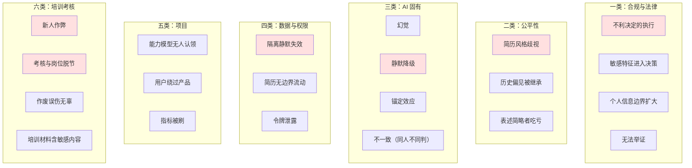

# 风险与合规

> 这份回答：**哪里会出事，怎么防。**
>
> AI 产品的风险清单比传统产品长一类：除了「做不出来」和「不好用」，
> 还多了「做出来了但不准」「准但不公平」「准但说不清为什么」。

---

## 1 风险全景

---

## 2 一类：合规与法律

### 2.1 不利决定的执行 —— 最高优先级

| 项 | 内容 |
| --- | --- |
| **风险** | 系统自动拒绝候选人，误判变成不可撤回的事实 |
| **后果** | 法律纠纷；且平台无法举证「这是一次误判」 |
| **措施** | 系统内**不存在「拒绝」这个动作**，只有「待定池 → 归档」 |
| **边界** | 归档不发送任何通知；是否告知由 HR 在 ATS 另行操作 |
| **兜底** | 归档记录仍可检索，不删除 |

**这是需求阶段与法务确认的边界，也是整个产品最硬的一条约束。**
它同时是一个产品决定：**把不利决定的执行权留在人手里。**

### 2.2 敏感特征

| 风险 | 措施 | 位置 |
| --- | --- | --- |
| 性别/年龄/婚育/籍贯/政治面貌进入打分链路 | 解析后即剥离，**不入链路** | 解析层 |
| 院校名称影响判断 | 院校与学历层次**拆开存储**，院校不参与打分 | 解析层 |
| 面试题涉及敏感话题 | 命中即**整条丢弃**并记录日志 | 出题层 |

**为什么院校要拆开存**：学历层次是能力相关信号，院校名称则高度相关于家庭背景，
两者混在一起会让筛选带上与岗位无关的偏见。

### 2.3 个人信息边界

| 风险 | 措施 |
| --- | --- |
| 为一场面试要求候选人注册 | 改用**一次性邀请链接**，不注册 |
| 候选人信息被无关人员看到 | 候选人页只返回本场信息（不含面试官、题目、评分、简历） |
| 联系方式被滥用 | 法务审计角色看联系方式时替换为「已隐藏」 |

**收集个人信息的第一原则是不收集。** 候选人不是平台用户，
不需要持续关系就不应该建立账号。

### 2.4 可举证性

| 项 | 措施 |
| --- | --- |
| 记录什么 | 谁、何时、基于什么（模型版本 + 提示词版本）做了什么决定 |
| 日志性质 | **只追加，不可编辑** |
| 为什么不可编辑 | 可编辑的日志在争议场景下不具备证明力（法务要求） |
| 可检索 | 按时间 / 候选人 / 操作人 |

---

## 3 二类：公平性

公平性风险的特点是**不会报错**。系统正常运行，只是某些人系统性地吃亏。

### 3.1 三种不公平的表现与措施

| 不公平 | 怎么发生 | 措施 |
| --- | --- | --- |
| **表述简略者吃亏** | 简历没写 ≠ 不具备，但被打成「不符合」 | 「未体现」不给分**也不计入分母** |
| **简历注水者占便宜** | 写得多就容易命中能力项 | 置信度独立计算；分母过小则置信度低 → 中间档强制人工 |
| **历史偏见被继承** | 用历史通过/否决样本定权重，继承历史偏好 | 权重初值走三路并行，专家校订环节专门查偏见 |

### 3.2 公平性无法完全自动检测

**这是必须承认的一点**。模型不会告诉你它不公平，
指标也测不出来（因为缺乏「反事实」数据 —— 你不知道被拒的人如果入职会怎样）。

所以措施只能是**流程性的**：

| 动作 | 频率 | 谁做 |
| --- | --- | --- |
| 抽查被否决样本，看是否有共性 | 每月 | HR 负责人 |
| 检查某能力项的失分是否集中在某类背景 | 每季度 | PM |
| 捞回样本复盘（误杀线索） | 每周 | HR 负责人 |

**捞回记录是这里最有价值的输入** —— 它是唯一能反事实的证据来源。

---

## 4 三类：AI 固有风险

### 4.1 幻觉

| 项 | 内容 |
| --- | --- |
| 风险 | 编造候选人简历里不存在的内容 |
| 为什么最严重 | 不只是这个分数错了，**整个系统的可信度都没了** |
| 措施 | 证据体强制非空 + 必须在原文定位；定位不到直接判失败 |
| 红线 | 幻觉率必须 **= 0**，不是 ≤ 某值 |

### 4.2 静默降级 —— 最容易被漏掉的一类

| 项 | 内容 |
| --- | --- |
| 风险 | 降级结果与正常结果**观感上没有差别** |
| 后果 | 面试官拿到一套通用模板题，以为是针对该候选人生成的 |
| 措施 | ①降级状态**常驻页面**，不是 5 秒 toast；②文案明说「不是针对该候选人生成的」；③提示「不能直接用于面试」 |
| 监控 | 降级率指标，红线 ≤ 3% |

**为什么单列**：它不报错、不崩溃、界面正常。如果不专门设计，用户永远不会知道。

### 4.3 锚定效应

| 项 | 内容 |
| --- | --- |
| 风险 | AI 给出评分建议，面试官倾向于微调而非独立判断 |
| 后果 | 表面上更高效，实际上评价独立性消失 —— 而「人的判断」是这套体系的最后防线 |
| 措施 | 面试官评分区**无任何 AI 预填值**（验收标准 A3-5） |
| 代价 | 接受这一条带来的效率损失 |

**这里做了一个反直觉的决定**：明确拒绝了「AI 面试评分建议」这个场景，
尽管它效率收益很大。理由写在 ADR 里。

### 4.4 不一致

| 项 | 内容 |
| --- | --- |
| 风险 | 同一份简历，两次判断不同 |
| 措施 | 路由**稳定优先**（同批次用同一模型）；能力分层选型；温度参数固定 |
| 监控 | 同一简历重复评测的档位一致率 |

**「稳定优先」是 AI 产品特有的一条路由原则**。
模型能力排行榜只看单次准确率，但产品需要的是「同一批数据用同一个模型」——
否则一批简历里会出现两种判断风格，用户会立刻发现并失去信任。

---

## 5 四类：数据与权限

### 5.1 隔离静默失效 —— 本项目实际发生过两次

| 次 | 表现 | 根因 |
| --- | --- | --- |
| 1 | 用人经理一个候选人都看不到 | 业务线是自由文本，账号填「电商业务线」、岗位填「电商线」 |
| 2 | 用人经理能看到**全部**候选人 | 隔离条件判断「部门」、过滤用「业务线」，没填部门就不过滤 |

**共同点**：都不报错，系统正常运行，只是数据范围错了。

| 措施 | 说明 |
| --- | --- |
| 业务线改为**受控字典** | 账号、岗位、知识库只能从中选择，后端同样校验 |
| 隔离条件与过滤条件必须同一字段 | code review 检查项 |
| 隔离在**查询层**强制 | 前端隐藏只能防误操作，防不住有心越权 |

### 5.2 两条合规硬约束

| 约束 | 原因 | 实现 |
| --- | --- | --- |
| 面试官只能看到被指派的候选人 | 避免简历在组织内无边界流动 | 查询条件强制加 `assignee_id == 当前用户` |
| 系统管理员不可查看简历正文 | 防止运维角色成为合规缺口 | 输出前统一脱敏 |

**第二条对超管同样生效** —— 这是合规要求，不可由权限提升绕过。

### 5.3 令牌泄露

| 风险 | 措施 |
| --- | --- |
| 令牌被猜出 | 32 字节随机串，非自增 id |
| 通过错误提示推断令牌是否存在 | 无效/过期/取消**统一返回同一句提示** |
| 链接被转发 | 只含本场信息；「重发链接」立即使旧链接失效 |
| 令牌长期有效 | 面试结束 24 小时后自动过期 |
| 面试官替候选人点同意 | 面试官端接口**不返回**邀请令牌 |

---

## 6 六类：培训考核

培训考核的风险特点是：**它不影响候选人，但影响在岗新人的评价与转正**，
所以处理原则与招聘侧不同 —— 招聘侧宁可不做，培训侧要在**公平与防作弊之间找平衡**。

### 6.1 新人作弊

| 项 | 内容 |
| --- | --- |
| **风险** | 新人在考核中查资料、代考、切屏搜答案 |
| **为什么特殊** | 浏览器事件**技术上防不住有心作弊的人**，而且会大量误伤无辜场景 |
| **措施** | 三层设计，**明确只有第一层是真实防线**： ① **服务端强制（不可绕过）**：答案不下发、开考即冻结试卷、服务端计时、每人随机组卷 + 选项乱序、限次与幂等交卷 ② **客户端信号（可绕过）**：切屏、粘贴、开发者工具、异常缩放 —— **仅作线索** ③ **人工复核（最终判断）**：带教人看信号明细后决定 |
| **关键约束** | **第二层不得自动判失败** |

**为什么第二层不能自动判失败**：接电话切出去、输入法弹窗、笔记本合盖、
网课页面同时开着 —— 这些正常行为都会触发信号。若据此自动判失败，
会直接违背需求分析的洞察二：**误杀的代价远高于漏放**。考核场景同理。

### 6.2 考核与岗位脱节

| 项 | 内容 |
| --- | --- |
| 风险 | 题库考的是「记住了多少文档」，而不是「能不能上手干活」 |
| 后果 | 考核成绩与试用期表现不相关 → 没人当真 → 数据回流失去意义 |
| 措施 | 出题**锚定到岗位能力项**（与筛选、面试共用同一套能力模型）；每题标注考察的能力项与出处 |
| 验证 | 用「考核成绩与试用期表现的相关性」检验，这也是该模块存在的理由 |

### 6.3 作废的误伤

| 项 | 内容 |
| --- | --- |
| 风险 | 带教人依据风险分作废成绩，可能误伤正常作答的新人 |
| 措施 | ① **风险分只用于排序，不自动判失败**；② 作废须带教人明确操作；③ **作废时返还考试机会** |
| 原则 | 与招聘侧一致：把判断权留给人，且给出可挽回的路径 |

### 6.4 培训材料的内容风险

| 项 | 内容 |
| --- | --- |
| 风险 | 上传的公司文档可能含答案泄漏、敏感信息或伪造指令 |
| 措施 | ① 检出「答案：B」式答案泄漏时**提示先清理**（仅警告不阻断）；② 文档按不可信内容处理，走与知识库相同的注入防护；③ **每题标注出处**，便于核对 |
| 说明 | 培训材料来自客户内部，质量参差，所以处理原则是「提示 + 可追溯」而非强行拦截 |

---

## 7 五类：项目风险

| 风险 | 表现 | 措施 |
| --- | --- | --- |
| 能力模型无人认领 | 没人维护权重，半年后过期 | 明确 HR 负责人为 owner，季度复盘为固定日程 |
| 用户绕过产品 | 私下用微信排面试、在别处记笔记 | 每周看「实际使用率」；这是最强负反馈信号 |
| 指标被刷 | 为提采纳率放宽阈值 | 北极星必须配护栏指标（见 07 文档） |
| 过度依赖单一模型 | 供应商变更导致能力波动 | 能力分层 + 亲和度表，换模型不改产品逻辑 |
| 成本失控 | 长文生成成本随使用量线性增长 | 按能力分层选型；监控单次成本 |

---

## 7 合规评审清单

上线前逐项确认，**任一项不通过不上线**。

| # | 检查项 | 通过标准 |
| --- | --- | --- |
| 1 | 系统内是否存在「拒绝」动作 | 不存在 |
| 2 | 归档是否触发对外通知 | 不触发 |
| 3 | 敏感特征是否入链路 | 完全剥离 |
| 4 | 证据是否可定位 | 定位失败即判失败 |
| 4b | 考核答案是否下发到客户端 | 不下发，判卷全在服务端 |
| 4c | 客户端信号能否单独判定作弊 | 不能，仅作线索，由带教人复核 |
| 4d | 考核限时与及格线能否被考生放宽 | 不能，服务端强制 |
| 5 | 系统管理员能否看到简历正文 | 不能 |
| 6 | 法务审计能否看到联系方式 | 不能 |
| 7 | 决策日志是否可编辑 | 不可编辑 |
| 8 | 日志是否记录模型与提示词版本 | 是 |
| 9 | 候选人是否被要求注册 | 否，使用一次性链接 |
| 10 | 邀请链接是否含面试官/题目/评分 | 不含 |
| 11 | 无效令牌提示是否泄露存在性 | 统一提示 |
| 12 | 面试官评分区是否有 AI 预填 | 无 |
| 13 | 降级是否在界面明示 | 是，常驻 |
| 14 | 业务线是否受控字典 | 是 |
| 15 | 隔离是否在查询层 | 是 |

---

## 8 出事时的处理原则

| 情况 | 立即动作 | 后续 |
| --- | --- | --- |
| 发现幻觉（编造简历内容） | 停止发布，回滚提示词版本 | 定位是提示词问题还是模型问题 |
| 考核被大规模作弊 | 暂停该场次判分，改走人工终评 | 检查服务端强制项是否被绕过，而非只调信号阈值 |
| 作废引发争议 | 调出信号明细与作答记录 | 复核判据是否合理；确属误伤则恢复成绩 |
| 发现隔离失效 | 立即修查询条件 | 排查是否已有数据越界，记录影响范围 |
| 邀请链接泄露 | 通知 HR 重发链接 | 检查是否有异常访问 |
| 候选人投诉筛选不公 | 调出决策日志 | 逐项说明依据；如确有误判，走人工复核 |
| 降级率突增 | 检查网关与模型可用性 | 恢复后重跑评测集 |

**共同原则：先止损，再定位，最后归因。**
AI 产品的故障处置比传统产品多一步 —— 传统产品恢复服务即可，
AI 产品还要确认「这段时间产出的结果能不能用」。

### 8.1 关于「结果能不能用」

| 故障类型 | 已产出结果是否可用 |
| --- | --- |
| 降级 | **不可直接使用**，需人工确认 |
| 网关不可用 | 未产出结果，转人工 |
| 隔离失效 | 数据越界，需记录并告知 |
| 提示词回滚 | 回滚前的产出需标记版本 |

**最后一条容易被忽略**：回滚之后，之前用问题版本产出的结果仍在库里。
必须能区分「哪些是问题版本产出的」，否则事后无法界定影响范围 ——
这也是决策日志记录版本号的用途之一。
