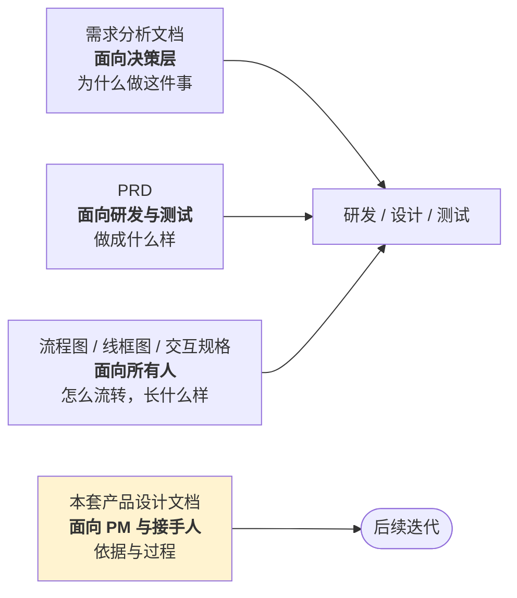

# 协作与交付

> 这份回答：**怎么和研发、设计、测试配合，以及怎么把需求交出去。**
>
> AI 产品最容易出问题的地方不在需求本身，而在**交接**：
> 「准确率要达标」这种需求交出去，研发不知道要做到什么程度，测试不知道该怎么验。

---

## 1 角色与分工

| 角色 | 在这个产品里负责什么 | 和 PM 的接口 |
| --- | --- | --- |
| **AI 产品经理** | 问题定义、场景选型、输出契约、评测标准、验收 | —— |
| 算法 / 提示词工程 | 提示词、模型选型、评测执行 | 输入：契约与标准；输出：评测报告 |
| 后端 | 接口、权限、隔离、日志、降级链路 | 输入：PRD + 交互规格；输出：接口文档 |
| 前端 | 页面、状态、交互、降级提示 | 输入：线框图 + 交互规格 |
| 设计 | 视觉、组件、AI 产出区域的区分 | 输入：线框图 |
| 测试 | 功能 + AI 质量 + 合规 + 越权 | 输入：验收标准 |
| 法务 / 合规 | 红线评审 | 输入：合规清单 |

### 1.1 PM 不做的事

| 不做 | 为什么 |
| --- | --- |
| 不写提示词 | 但**定义输出契约**与评测标准 —— 提示词是实现，契约是需求 |
| 不确定阈值 | 但**定义阈值的作用与调优方向** |
| 不做视觉设计 | 但**定义信息层级与状态要求** |
| 不写测试用例 | 但**定义验收标准**（尤其 AI 质量怎么算达标） |

**边界的关键在于**：PM 负责「什么算对」，工程负责「怎么做到」。
「准确率要高一点」既不是前者也不是后者，它是无效需求。

---

## 2 需求交接：三份文档，三个读者

| 文档 | 一句话定位 | 什么时候更新 |
| --- | --- | --- |
| 需求分析 | 为什么做，不做什么 | 立项与重大方向调整 |
| PRD | 功能规则、字段、异常、验收 | 需求变更时 |
| 流程图 | 状态流转、判定逻辑 | **代码改动时同步** |
| 线框图 | 信息层级 | 设计阶段 |
| 交互规格 | 字段、状态、空态、异常 | 与开发同步迭代 |
| 产品设计 | 依据、决策记录、方法 | 有新的决策或复盘时 |

**「流程图改动代码时同步」这条要写进规范**。
一张与实现不符的流程图，比没有流程图更容易误导人 —— 它会让人按错的逻辑去改代码。

---

## 3 和研发的协作：接口契约先行

AI 产品特有的一个交接点：**AI 产出的接口契约**。

### 3.1 必须先定的四件事

| # | 要定什么 | 举例 |
| --- | --- | --- |
| 1 | 结果体的字段与枚举值 | 档位只能是「高分档/中间档/低分档」 |
| 2 | 证据体的结构 | 原文片段 + 起止位置 |
| 3 | 失败时返回什么 | 校验失败 → 不产出结果，转人工 |
| 4 | 元信息含什么 | 模型版本、提示词版本、置信度、耗时、是否降级 |

**第 3 条最容易被漏**。如果只定义了成功时的返回，
失败时研发会顺手返回一个空对象或默认值 —— 那正是静默降级的来源。

### 3.2 接口评审的三个必问

| 问题 | 想确认什么 |
| --- | --- |
| 校验失败时返回什么？ | 有没有变成静默降级 |
| 降级信息怎么传？ | 前端能不能显示常驻提示 |
| 置信度给不给业务方？ | 会不会被误读成百分比 |

**第二问的产品含义**：降级信息必须能传到界面并常驻显示。
如果接口只返回一个 `degraded: true` 而没有原因，界面就只能写「出错了」，
用户无法判断该不该用。

---

## 4 和设计的协作

设计拿到的不该是「一个页面」，而是**这个页面的信息层级与状态要求**。

### 4.1 交给设计的四样东西

| 交付物 | 说明 |
| --- | --- |
| 线框图 | 布局与信息优先级 |
| 状态清单 | 加载 / 空态 / 异常 各自的文案与表现 |
| AI 区域标注 | 哪些内容是 AI 产出，必须视觉区分 |
| 危险操作清单 | 哪些动作要确认，确认框要写什么 |

### 4.2 设计必须遵守的三条（来自 ADR）

| # | 规则 | 出处 |
| --- | --- | --- |
| 1 | AI 产出与人工输入**视觉分离**，不混排 | ADR：防锚定效应 |
| 2 | 降级提示**常驻页面**，不用 toast | ADR：禁止静默降级 |
| 3 | 采纳与否决**不设默认选中** | ADR-003 |

**这三条不是设计偏好，是产品约束** —— 设计可以决定怎么实现，不能决定要不要。

### 4.3 空态文案为什么 PM 要写

空态文案是**产品决策**，不是文案工作。它要回答：
用户为什么看到空的、下一步该做什么。

设计可以优化措辞，但「下一步做什么」必须由 PM 给。

---

## 5 和测试的协作

AI 产品的测试比传统产品多两类：**AI 质量**与**合规边界**。

### 5.1 四类测试

| 类别 | 测什么 | 谁来定义验收 |
| --- | --- | --- |
| 功能 | 流程走通、状态流转正确 | PM |
| **AI 质量** | 一致率、幻觉率、证据可用率 | PM 定标准，算法执行 |
| **合规** | 见 09 文档的 15 项清单 | PM 定，法务确认 |
| 越权 | 各角色的数据范围与操作权限 | PM 定 |

### 5.2 必须写进测试用例的四条

| # | 用例 | 为什么必须有 |
| --- | --- | --- |
| 1 | 面试官访问未被指派的候选人 | 隔离是合规硬约束 |
| 2 | 系统管理员访问简历正文 | 应为占位文本 |
| 3 | 伪造/过期/取消的邀请链接 | 统一 404，不泄露存在性 |
| 4 | 选项乱序后的判分 | 漏掉反映射会全盘判错，且不报错 |

**第 4 条的特别之处**：它的错误结果是「全错」而不是「报错」，
很容易被当成「这次题太难」。所以它必须进用例，不能靠 code review。

### 5.3 AI 质量怎么验

| 项 | 做法 |
| --- | --- |
| 评测集 | 80 份标注样本，边界样本占 25% |
| 触发时机 | 改提示词、换模型、改阈值时**必须重跑** |
| 通过标准 | 见 06 文档的五项 |
| 谁来跑 | 算法，PM 审报告 |

**「边界样本占 25%」是硬要求**：只用正负样本会高估模型 ——
真实场景里最难的是「差不多」的那些人。

---

## 6 本项目的实际交付节奏

| 阶段 | 产出 | 验收方式 |
| --- | --- | --- |
| 第 1 月 | 需求分析、能力模型 v1 | 评审会通过 |
| 第 2 月 | PRD、流程图、线框图、评测集 | 需求评审 + 评测基线 |
| 第 3 月 | 四模块开发完成 | 功能测试 + AI 质量测试 |
| 交付 | 双分发包（离线版 / GitHub 版） | 干净环境验证 |
| 交付后 | 三个缺陷修复 | 回归 + 端到端测试 |

### 6.1 交付后的缺陷修复 —— 一个真实的教训

交付后试用阶段发现了三个缺陷，值得作为协作案例记下来：

| 缺陷 | 表面现象 | 真实根因 |
| --- | --- | --- |
| 无法指派面试官 | 所有面试都堆在同一人 | 后端缺省静默挂到第一个面试官；前端没有选择项 |
| 业务线无法增删 | 下拉框只有写死的 4 项 | 业务线在前端硬编码、在岗位处自由输入 |
| 视频面试不知从哪进 | 候选人没有账号 | 产品缺少候选人侧入口与会议链接字段 |

**三个的共同点：都不是「少了功能」，而是已有设计里的静默失效。**

这类缺陷在测试阶段很难发现，因为**功能都是通的**，只是结果不对。
它们的共同特征值得记下来：

| 特征 | 说明 |
| --- | --- |
| 有缺省值 | 缺省值掩盖了「用户没选」这件事 |
| 字符串比较 | 字面不一致导致静默过滤，无报错 |
| 角色缺入口 | 某个角色的使用路径根本没有页面 |

**对应的检查方法**（可以进 review checklist）：

1. 任何 `or` 形式的缺省赋值，问一句：用户没选时会发生什么？
2. 任何按字符串过滤的地方，问一句：这个字符串从哪来、可能不一致吗？
3. 每个角色，问一句：他的完整操作路径走通了吗？

---

## 7 交接清单

新人接手时，按这个顺序读：

| # | 文档 | 目的 |
| --- | --- | --- |
| 1 | 需求分析文档 | 知道为什么做、不做什么 |
| 2 | PRD | 知道做成什么样 |
| 3 | 流程图 | 知道怎么流转 |
| 4 | 交互规格 | 知道每个页面的细节 |
| 5 | ADR | **知道为什么不能那样改** |
| 6 | 评测集文档 | 知道怎么算改好了 |
| 7 | 埋点与指标 | 知道上线后看什么 |
| 8 | 风险与合规 | 知道哪里碰不得 |

**第 5 项要单独强调**。新人最容易做的一件事，是把当初经过权衡的设计推翻重做 ——
不是因为他们错，而是因为他们不知道当时为什么这么定。
ADR 的作用就是让这个「为什么」能传下去。
